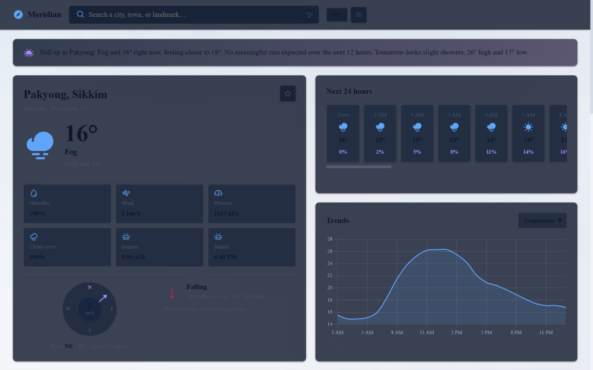
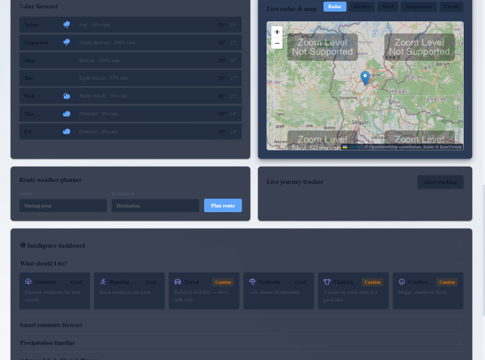
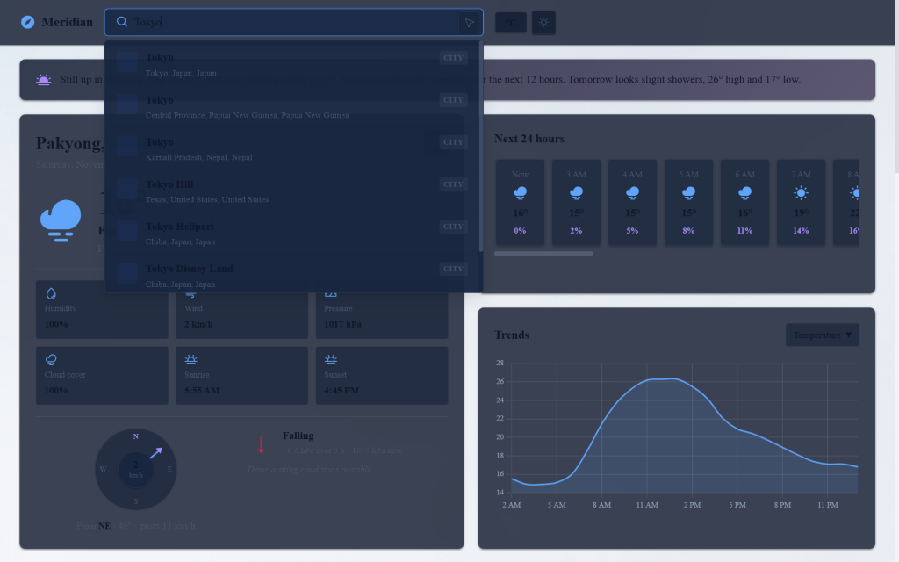
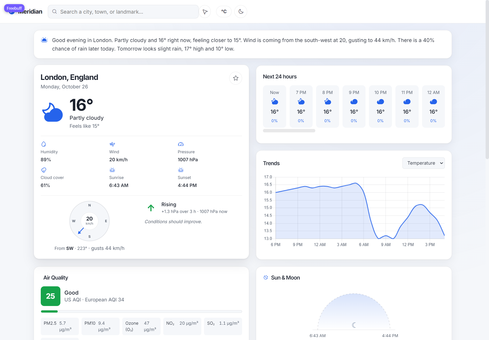

# Meridian — Real-Time Weather Application

[](https://zuhayr420.github.io/Weather-Application/)
[](https://github.com/zuhayr420/Weather-Application/actions/workflows/ci.yml)
[](https://github.com/zuhayr420/Weather-Application/actions/workflows/codeql.yml)
[](CHANGELOG.md)
[](LICENSE)
[](https://www.python.org/)
[](https://fastapi.tiangolo.com/)
[](https://open-meteo.com)
[](https://www.openstreetmap.org/)

## Interface Preview

| Light Mode (Editorial Glass) | Dark Mode (Night Slate) |
| :---: | :---: |
|  |  |

| Deep Geocoding Autocomplete | Interactive Map & Synoptic Telemetry |
| :---: | :---: |
|  |  |

**Meridian** is a real-time global weather platform and meteorological intelligence dashboard. Designed with an editorial **Times New Roman** interface and built with a high-performance **FastAPI** backend and **Vanilla JavaScript** frontend, Meridian provides hyper-local weather metrics, interactive radar loops, driving route weather hazard analysis, environmental air quality monitoring, and 5-year climate anomaly detection.

---

## Key Features

### 1. Deepest-Level Global Hybrid Geocoding
- **Coordinate Parsing**: Search directly by decimal (`27.1822, 88.5033`) or cardinal (`40.7128N, 74.0060W`) GPS coordinates.
- **Parallel Multi-Engine Search**: Concurrently queries **OpenStreetMap Nominatim**, **Komoot Photon Elasticsearch**, **Wikipedia MediaWiki Geosearch**, and **Open-Meteo Geocoding** in `<1.5s`.
- **Micro-Towns, Hamlets & Landmarks**: Deep support for remote alpine hamlets (e.g. *Gurudongmar Lake*, *Dzuluk/Zuluk*), natural valleys, peaks, beaches, parks, transit roads, and global addresses.
- **Multi-Signal Relevance Scoring**: Ranks results intelligently, filtering out unrelated fuzzy matches while prioritizing populated settlements and verified geographic landmarks.

### 2. Meteorological Forecaster
- **Current Conditions**: Real-time temperature, apparent ("feels like") temperature, humidity, pressure, cloud cover, and wind velocity.
- **24-Hour Hourly Strip**: Hour-by-hour temperature, weather glyphs, and precipitation probability.
- **7-Day Synoptic Forecast**: Daily temperature spreads with maximum precipitation risk.
- **Interactive Trend Charts**: Smooth Chart.js visualizer for temperature, precipitation volume, and wind speed.
- **Automated Weather Narratives**: Natural language synopsis generated on every location update.

### 3. Atmospheric & Environmental Science
- **Air Quality (AQI)**: United States Air Quality Index with real-time pollutant breakdown ($\text{PM}_{2.5}$, $\text{PM}_{10}$, $\text{NO}_2$, $\text{SO}_2$, $\text{CO}$, $\text{O}_3$).
- **Solar & Lunar Astronomy**: Interactive SVG sun-arc tracking current solar elevation, exact sunrise/sunset, golden hour, blue hour, and celestial moon phase.
- **Wind Compass**: 360° directional rose with real-time vector needle and wind speed indicator.
- **Barometric Pressure Tendency**: 3-hour pressure delta analysis with meteorological outlook.

### 4. Interactive Radar, Satellite & Weather Map
- Powered by **Leaflet.js** and **RainViewer**.
- **Live Radar Loop**: Animated precipitation radar with play/pause and timestamp slider.
- **Layer Switching**: High-resolution satellite imagery, OpenStreetMap basemap, and interpolated temperature/wind/cloud fields.

### 5. Driving Route Weather Planner & Journey Tracker
- **Waypoint Weather Hazards**: Enter origin and destination to compute OSRM driving routes and evaluate weather safety at intermediate waypoints.
- **Live GPS Journey Tracker**: In-browser GPS tracking displaying real-time speed, heading, altitude, and journey breadcrumbs.

### 6. Climate Intelligence Dashboard
- **Thermal Comfort Analysis**: Detailed breakdown of apparent temperature variance driven by wind chill, solar radiation, and relative humidity.
- **5-Year Climate Anomaly Detection**: Evaluates current conditions against a 5-year Open-Meteo Archive baseline, computing $z$-score temperature anomalies.
- **Commute Forecaster**: Morning and evening commute weather outlooks.
- **Activity & Outfit Recommendations**: Algorithmic attire and outdoor activity guidance.
- **Multi-Location Comparison**: Compare micro-climates across multiple cities in a structured comparison grid.

---

## Design System

- **Typography**: Exclusive **Times New Roman** editorial typography (`"Times New Roman", Times, Georgia, serif`) across all pages, headings, dashboard cards, tooltips, tables, and Chart.js graphs.
- **Color Palette**: Light Mode features soft oceanic sky blue (`#f3f7fb`), pure white liquid glass surfaces, and subtle violet accents (`#7c5ce8` / `#2563eb`). Dark Mode features a deep night slate (`#0b111e`) with silver typography.
- **Weather-Reactive Contrast**: High-contrast dark surfaces for extreme snow and sub-zero environments (e.g. Gurudongmar) ensuring readability in bright sunlight or blinding snow.
- **No AI Clutter**: Restrained corner radii (3px–8px), subtle hairline borders, and zero bouncing hover effects.

---

## Architecture & Deployment

Meridian supports two flexible deployment modes:

```
                      ┌────────────────────────────────────────┐
                      │              Web Browser               │
                      │  Vanilla JS (ES6+), Leaflet, Chart.js  │
                      └───────────────────┬────────────────────┘
                                          │
                      ┌───────────────────┴────────────────────┐
                      ▼                                        ▼
           [Mode 1: Full-Stack]                       [Mode 2: Static]
         FastAPI Backend (:8000)                  Pure Client-Side Static
       ┌────────────────────────┐                 (GitHub / Cloudflare Pages)
       │ • Deep Geocode Engine  │                          │
       │ • Multi-Engine Scoring │                          │
       │ • Static Asset Server  │                          │
       └───────────┬────────────┘                          │
                   │                                       │
    ┌──────────────┴───────────────┐                       │
    ▼              ▼               ▼                       ▼
OpenStreetMap   Photon         Wikipedia              Open-Meteo
  (Nominatim)  (Komoot)       (MediaWiki)             Direct API
```

### Mode 1: Full-Stack Production (Recommended)
Runs the FastAPI server which acts as the application host and provides the parallel geocoding engine with memory caching.

#### Prerequisites
- Python 3.10 or higher

#### Quickstart
```bash
# 1. Clone the repository
git clone https://github.com/your-username/meridian-weather.git
cd meridian-weather

# 2. Install dependencies
pip install -r requirements.txt

# 3. Start the application
uvicorn main:app --host 127.0.0.1 --port 8000
```
Open **`http://localhost:8000`** in your browser.

### Mode 2: Static Client-Only Deployment
The frontend can also run standalone without a server. Simply host the `frontend/` directory on GitHub Pages, Cloudflare Pages, Netlify, or Vercel.

```bash
cd frontend
python -m http.server 8000
```

---

## Project Structure

```
meridian-weather/
├── backend/
│   ├── main.py              # FastAPI server & Deep Hybrid Geocoding Engine
│   └── requirements.txt     # Python backend dependencies
├── frontend/
│   ├── index.html           # Core single-page application structure
│   ├── manifest.json        # Progressive Web App (PWA) manifest
│   ├── sw.js                # Service Worker for offline shell caching
│   ├── css/
│   │   └── styles.css       # Design tokens, Times New Roman rules, glass cards
│   ├── icons/               # Application icons
│   └── js/
│       ├── weatherService.js # Meteorological API orchestration & caching
│       ├── search.js        # Global search autocomplete & keyboard navigation
│       ├── app.js           # Core weather dashboard, forecasts & Chart.js
│       ├── mapLayers.js     # Leaflet map, radar animation loop & layer toggle
│       ├── airQuality.js    # US AQI meter & pollutant spectrum
│       ├── astronomy.js     # Sun elevation arc, twilight hours & moon phase
│       ├── windCompass.js   # Dynamic 360-degree wind compass
│       ├── pressureTrend.js # 3-hour barometric pressure tendency
│       ├── route.js         # Driving route hazard analyzer (OSRM)
│       ├── journey.js       # Real-time GPS journey tracking module
│       ├── intelligence.js  # Climate anomalies, commute, outfits & comparisons
│       ├── theme.js         # Dark/light theme & unit toggling (°C/°F)
│       └── weatherEffects.js# Atmospheric canvas particle simulation
├── docs/
│   ├── dashboard.png        # Light mode dashboard preview
│   ├── dark_mode.png        # High-contrast night slate preview
│   ├── search_autocomplete.png # Hybrid deep geocoding search demonstration
│   └── preview.png          # Synoptic overview preview
├── main.py                  # Root application entrypoint
├── requirements.txt         # Root Python requirements
├── .gitignore               # Comprehensive Git ignore rules
├── LICENSE                  # MIT License
└── README.md                # Project documentation
```

---

## Data Sources & Attribution

All weather, mapping, and geocoding services used in Meridian are powered by free, keyless, and open resources:

- **Weather & Climate Data**: [Open-Meteo](https://open-meteo.com/) (Forecast, Historical Archive, and Air Quality APIs under CC BY 4.0).
- **Geocoding & Map Data**: [OpenStreetMap](https://www.openstreetmap.org/) contributors, [Nominatim](https://nominatim.org/), and [Komoot Photon](https://photon.komoot.io/).
- **Geographic Knowledge**: [Wikipedia](https://www.wikipedia.org/) via MediaWiki API.
- **Radar Imagery**: [RainViewer](https://www.rainviewer.com/) Radar API.
- **Routing Geometry**: [OSRM](http://project-osrm.org/) (Open Source Routing Machine).
- **Reverse Geocoding**: [BigDataCloud](https://www.bigdatacloud.com/) Client Geocoding API.

---

## Community & Contributing

We welcome contributions! Please review our guidelines before submitting pull requests:
- [Contributing Guide](CONTRIBUTING.md)
- [Code of Conduct](CODE_OF_CONDUCT.md)
- [Security Policy](SECURITY.md)
- [Changelog](CHANGELOG.md)

---

## License

This project is licensed under the [MIT License](LICENSE).
